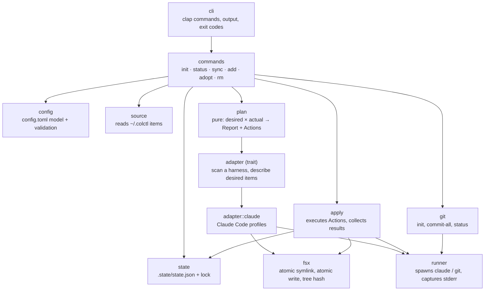

# Components (C4 level 3): the colctl binary

| Component | One job | Depends on |
|---|---|---|
| `config` | Parse and validate `config.toml`; expand `~`; resolve `$COLCTL_HOME` | — |
| `source` | List items in the source store (skills, agents, `AGENTS.md`) | `fsx` |
| `state` | Load/save `.state/state.json`; take and release the lock | `fsx` |
| `adapter` | Trait: `scan(harness) -> Actual`, `desired(source, config) -> Desired`, action kinds it supports | — |
| `adapter::claude` | Claude Code specifics: `CLAUDE.md` import, `skills/`, `agents/`, plugin JSON reading, `claude plugin` args and env | `fsx`, `runner` |
| `plan` | **Pure.** Compare desired with actual per harness → item statuses (`Report`) and an ordered `Vec<Action>` | `adapter` types |
| `apply` | Execute actions; one harness failing doesn't stop others; update state after each success | `fsx`, `runner`, `state` |
| `fsx` | Filesystem primitives that are safe by construction: create-link-then-rename, write-temp-then-rename, never replace a real file/dir, sha256 of files and trees | std |
| `runner` | Run a program with an explicit env (set and unset lists), capture exit code, stdout, stderr; injectable for tests | std |
| `git` | `init`, `commit_all(message)`, `is_dirty` | `runner` |
| `commands` | Wire the above together per subcommand | all |
| `cli` | Argument parsing, human and `--json` rendering, exit codes | `commands` |

**Seams for testing:** `plan` is pure; `runner` takes a program path so tests put a fake `claude` and a real `git` on a
temp `PATH`; the whole binary runs against a temp `HOME` / `$COLCTL_HOME`.
