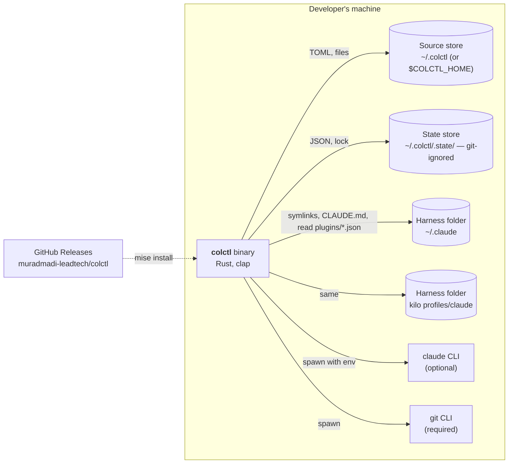

# Containers (C4 level 2): Claude profile sync

colctl is a single Rust binary. Everything else it touches is a folder or another program.

| Container | Technology | Responsibility |
|---|---|---|
| colctl binary | Rust 2024, single crate | All behaviour |
| Source store | Plain files + git repo | `config.toml`, `AGENTS.md`, `skills/`, `agents/` — what the user owns and edits |
| State store | JSON + lock file | What colctl generated or installed, per harness, with hashes. Machine-specific, so git-ignored |
| Harness folders | Claude Code config dirs | Targets; colctl only writes symlinks and `CLAUDE.md` there |
| claude CLI | External, optional | Installs/uninstalls marketplaces and plugins into a given profile |
| git CLI | External, required | History of the source store |
| GitHub Releases | CI (`publish.yml`) | macOS arm64 + Linux x86_64 archives with attestations |
