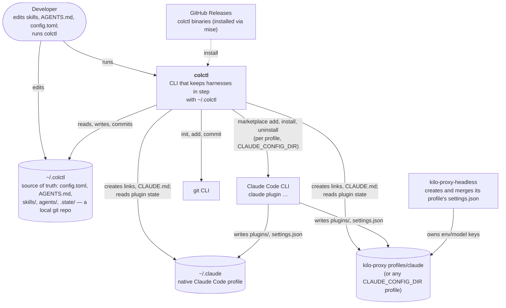

# System context (C4 level 1): Claude profile sync

**Boundaries**
- colctl writes **only** inside `~/.colctl` and, inside each harness, symlinks under `skills/` and `agents/` plus a
  generated `CLAUDE.md`.
- Everything under a harness's `plugins/` and its `settings.json` is written by Claude Code's CLI (or kilo), never by
  colctl.
- colctl never creates a harness folder; harnesses are created by their own tools (Claude Code, kilo-proxy).
