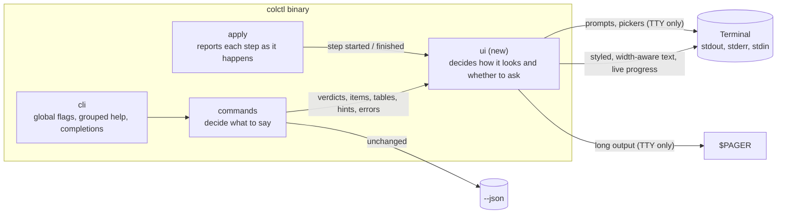

# Containers (C4 level 2): CLI output design

| Container | Change in cycle 6 |
|---|---|
| `ui` (new module tree) | Owns every byte of human output: terminal detection, colour policy, symbols, components, progress, prompts, pager |
| `commands` | Build structured results and hand them to `ui`; no direct printing. JSON paths unchanged |
| `apply` | Emits step events (started, done, failed, skipped) instead of the caller printing a log afterwards |
| `cli` | Global `--color`, `-q`, `-v`, `--yes`, `--no-pager`; grouped help with examples; `completions` subcommand; clap errors in colctl's error style |

### New dependencies (each small and standard)

| Crate | Why |
|---|---|
| `console` | Terminal detection, width, styling, `NO_COLOR`/`CLICOLOR_FORCE` handling, ANSI-aware text width |
| `indicatif` | Live progress (spinners, per-profile bars), drawn only to a terminal; same family as `console` |
| `dialoguer` | Confirm and select prompts; same family, so one terminal model |
| `clap_complete` | `colctl completions bash\|zsh\|fish` |
| `insta` (dev only) | Snapshot tests of rendered output |
