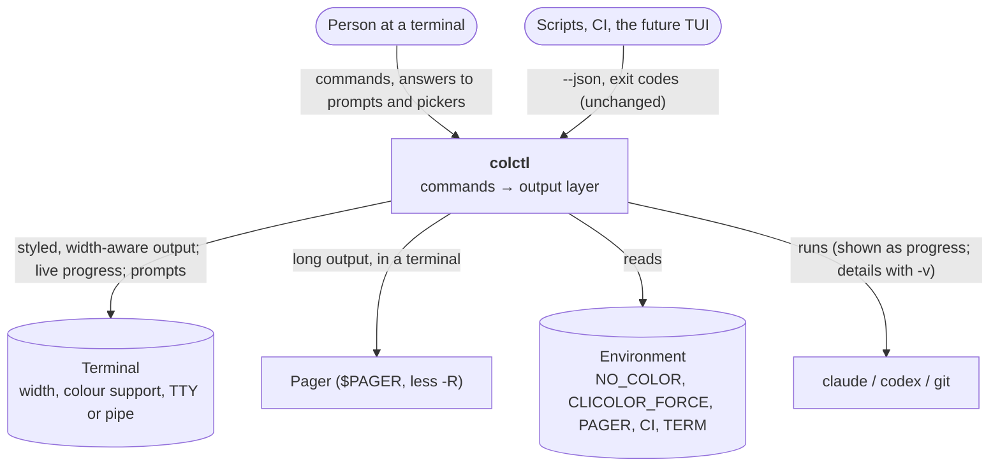

# System context (C4 level 1): CLI output design

**Boundaries**
- The output layer decides how things look and whether to ask; commands decide what to say. `--json` and exit codes
  bypass the output layer's styling and are unchanged.
- Interaction (prompts, pickers, pager) happens only when stdin and stdout are terminals and `--json` isn't set;
  otherwise colctl behaves exactly as a script expects.
- No full-screen mode: everything prints into the normal scrollback.
