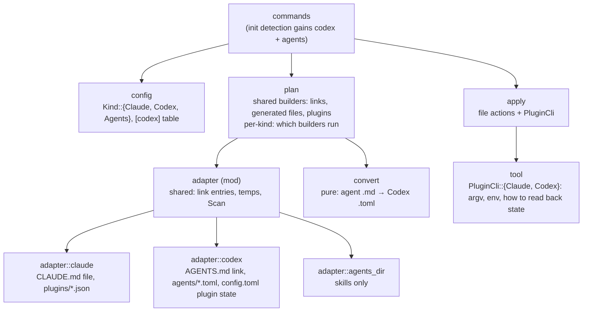

# Components (C4 level 3): Codex CLI support

Cycle 1 put Claude specifics in `adapter.rs`, `plan.rs` and `apply.rs`. Cycle 2 splits each into a part shared by
every kind and a part per kind, so a third kind (OpenCode, …) later is a new module, not edits everywhere.

| Component | One job | New / changed |
|---|---|---|
| `config` | Parse and validate `config.toml` | Changed: `kind = "codex" \| "agents"`; optional `[codex.marketplaces]` and `[codex.plugins].enabled`; `add_plugin`/`remove_plugin` take the list to edit |
| `adapter` (mod) | Types every kind shares (`Scan`, `Entry`, link scanning, temp detection) | Changed: split from today's `adapter.rs` |
| `adapter::claude` | Read a Claude profile | Moved, unchanged behaviour |
| `adapter::codex` | Read a Codex profile: `AGENTS.md` as a link entry, `agents/*.toml` as generated files, `config.toml` → installed plugins and known marketplaces | New |
| `adapter::agents_dir` | Read `~/.agents/skills` | New |
| `convert` | **Pure.** Parse an agent's YAML frontmatter and body, then render the Codex TOML (or say why it can't) | New |
| `plan` | Pure planner. Shared builders: `links` (skills; Claude agents), `instructions_file` (Claude), `instructions_link` (Codex), `generated_files` (Codex agents), `plugins` (both CLIs). Each kind picks its builders | Changed |
| `tool` | Everything about calling a plugin CLI: argv per action, env to set and remove, how to read state back after a call | New, extracted from `apply` |
| `apply` | Execute actions | Changed: plugin actions carry a `Tool`; new `WriteGenerated`/`RemoveGenerated` for agent TOML |
| `commands` | Wire it together | Changed: `init` detection; `add`/`rm plugin --codex`; `adopt` for codex/agents items |

**Seams for testing:** `convert` and `plan` stay pure; `examples/fake_codex.rs` stands in for `codex` the way
`fake_claude` does for `claude`.
