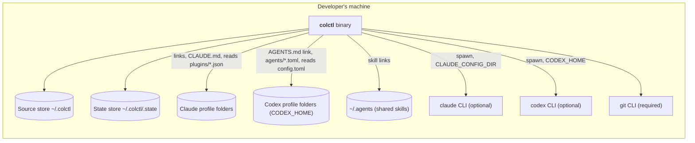

# Containers (C4 level 2): Codex CLI support

Still one Rust binary. The new outside pieces are the Codex CLI and two new kinds of folder.

| Container | Change in cycle 2 |
|---|---|
| colctl binary | Two new harness kinds, a Codex plugin list, agent conversion |
| Source store | Unchanged layout. `config.toml` gains an optional `[codex]` table |
| State store | Unchanged shape. `generated` now also holds `agents/<name>.toml` hashes for codex harnesses |
| Codex profile folders | New target. colctl writes `AGENTS.md` (symlink) and `agents/*.toml`; reads `config.toml` |
| `~/.agents` | New target. colctl writes symlinks under `skills/` only |
| codex CLI | New, optional. Like `claude`: if it's missing, file work still happens and plugin actions are skipped |
