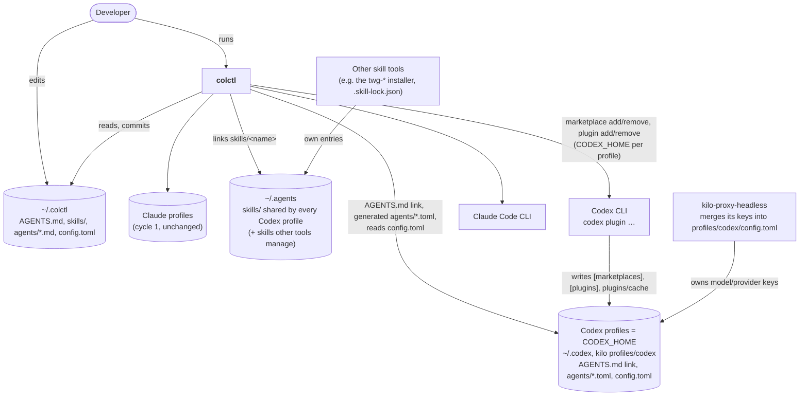

# System context (C4 level 1): Codex CLI support

**Boundaries**
- In a codex harness colctl writes only `AGENTS.md` (a symlink) and the `agents/*.toml` files it generates. Its
  `config.toml` is changed only by the Codex CLI and kilo.
- In `~/.agents` colctl writes only symlinks under `skills/`. Everything else there belongs to other tools.
- colctl never creates a harness folder.
