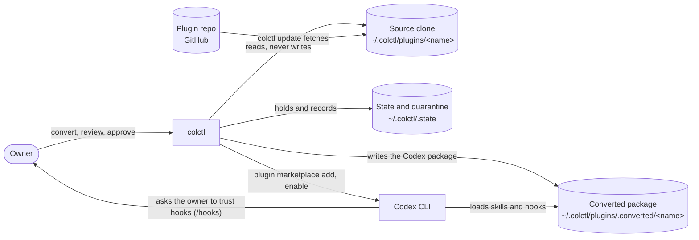

# System context: convert (C4 level 1)

| Element | Role | Owned by |
|---|---|---|
| Source clone | The pinned repo, as reviewed. Read only for conversion | colctl (cycle 3) |
| Converted package | `.codex-plugin/plugin.json`, the skills and the supported hooks, generated from one commit | colctl (new) |
| State and quarantine | Which sources convert, what's held, what's installed | colctl (cycles 3, 4) |
| Codex CLI | Installs the package from colctl's wrapper marketplace (cycle 6, T0) and runs it | OpenAI |
| Owner | Opts in, reviews the conversion, trusts hooks in Codex | — |

Trust boundaries: the plugin repo is untrusted content, reviewed before install (cycle 4). Hooks are code; colctl
copies them unchanged and flags them in review, and Codex asks the owner again before running them.
