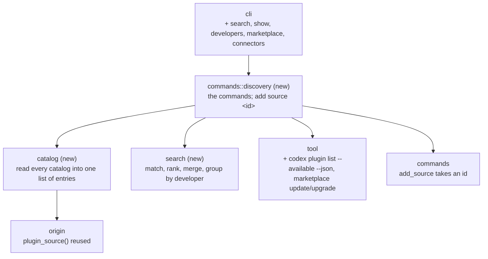

# Components (C4 level 3): Discovery

| Component | One job | New / changed |
|---|---|---|
| `catalog` | Builds `Entry` values (id, name, marketplace, tool, description, keywords, author, repo, subpath, version or commit, catalog kind) from: each Claude profile's known marketplaces and their manifests; the plugin-directory cache; each Codex profile's local and git marketplaces; colctl's sources. Marks where each is installed. Never fails as a whole: an unreadable catalog becomes a warning | New |
| `search` | Pure. Merges entries that are the same plugin (same normalised repo and subpath and name, or the same id), tokenises the query, scores name > keywords > description > developer, applies filters, sorts. Groups by developer (repo owner, else author). | New |
| `commands::discovery` | `search`, `show`, `developers`, `marketplace list`, `marketplace refresh`, `connectors`; text and JSON. Resolves `add source <id>` to (repo, subpath, plugin) | New |
| `commands` (`add_source`) | Accepts an id from the catalog as well as a repo | Changed |
| `origin` | `plugin_source` (a manifest entry → repo and subpath) is shared with `catalog` | Changed (visibility) |
| `tool` | The Codex catalog call and the refresh calls, with the same environment rules as other tool calls | Changed |
| `cli` | New subcommands | Changed |

**Seams for testing:** `search` is pure and gets table tests. `catalog` runs on fixture profile folders (manifests, a
small directory cache). Connectors use the fake `codex`, which learns `plugin list --available --json`. A generated
catalog of about 4,000 entries checks SC-6's timing.
