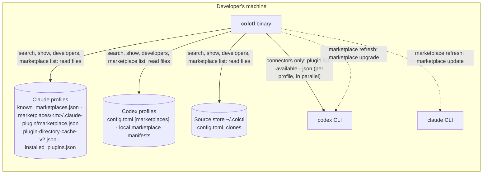

# Containers (C4 level 2): Discovery

| Container | Change in cycle 5 |
|---|---|
| Claude profiles | Read only: their marketplace list, every marketplace manifest, the plugin-directory cache and installed plugins |
| Codex profiles | Read only: `config.toml` marketplaces and the manifests of local or git marketplaces |
| codex CLI | `plugin list --available --json` for `connectors` (remote entries have no files to read); `plugin marketplace upgrade` for `refresh` |
| claude CLI | `plugin marketplace update` for `refresh` |
| Source store | Read for "already a source"; `add source <id>` writes it as in cycle 3 |

No new files. Nothing is cached by colctl: the tools' own caches are the catalog, so discovery is never staler than
the tools themselves.
