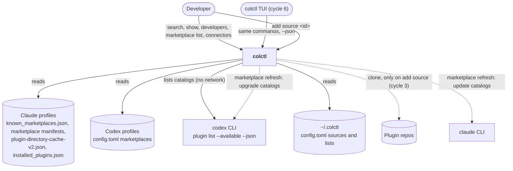

# System context (C4 level 1): Discovery

**Boundaries**
- Discovery reads catalogs that Claude and Codex already keep. It never writes them, except through the tools' own
  `marketplace update`/`upgrade` in `marketplace refresh`.
- Nothing is installed by discovery itself. `add source <id>` is the existing cycle 3 path with the repo looked up.
- No network outside `marketplace refresh` and `add source`.
