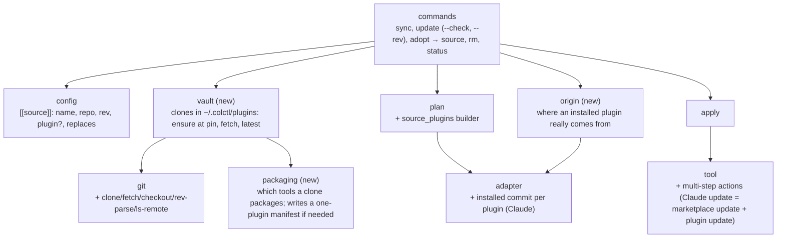

# Components (C4 level 3): Plugins from source

| Component | One job | New / changed |
|---|---|---|
| `config` | `[[source]]` tables: `name`, `repo`, `rev` (full commit), optional `plugin` (name in the repo's manifest; default `name`) and `replaces` (aggregator ids to uninstall). Edits keep comments | Changed |
| `git` | Adds `clone`, `fetch`, `checkout`, `rev_parse`, `ls_remote_head`, `is_clean` | Changed |
| `vault` | One clone per source plugin: create it, put it at the pin (fetching if the commit is missing), refuse a dirty clone, and report the upstream head for `update` | New |
| `packaging` | Inspect a clone: the Claude and Codex marketplace manifests and the plugin's entry in each, or plugin-only manifests (then write a one-plugin manifest in `plugins/.manifests/<name>`). Result: per tool, the marketplace folder, marketplace name and plugin id, or "unsupported" | New |
| `origin` | For an installed plugin, find its source repo and commit: Claude's directory bindings and `gitCommitSha`, a marketplace manifest's plugin entry (another repo or a path inside the marketplace repo), Codex's marketplace source | New |
| `plan` | `source_plugins` builder per claude/codex harness: local marketplace present, plugin installed at the pin, update if the pin moved, uninstall `replaces`, `unsupported` items; `from-aggregator` for foreign plugins whose origin is known | Changed |
| `tool` | An action may need several calls (Claude update: `marketplace update` then `plugin update`; Codex update: `plugin add`) | Changed |
| `commands` | Wires the vault in before planning; `update`, adopt-to-source, `rm` of a source plugin | Changed |

**Seams for testing:** "upstream" repos in tests are local git repos (`file://`), so nothing touches the network. The
fakes learn local-folder marketplaces (reading the manifest's name) and the update commands. `packaging`,
`origin` and `plan` are testable on temp folders without any CLI.
