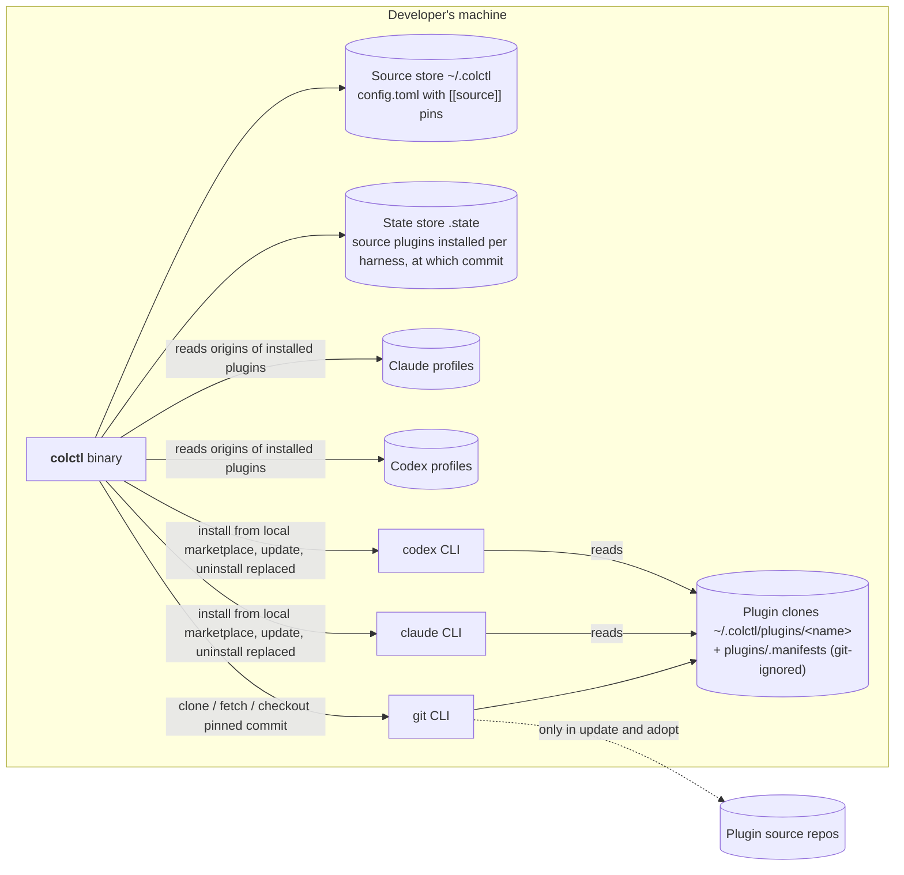

# Containers (C4 level 2): Plugins from source

| Container | Change in cycle 3 |
|---|---|
| Source store | `config.toml` gains `[[source]]` entries (repo, pinned `rev`, optional `replaces`). `.gitignore` gains `plugins/` |
| Plugin clones | New. One git clone per source plugin, checked out at its pin. Colctl-written manifests for repos that lack them live in `plugins/.manifests/<name>/` |
| State store | `harnesses.<h>.sources`: source plugin → commit colctl installed there |
| git CLI | Now also talks to the network, but only from `adopt`, `update` and the first clone of a newly declared source |
