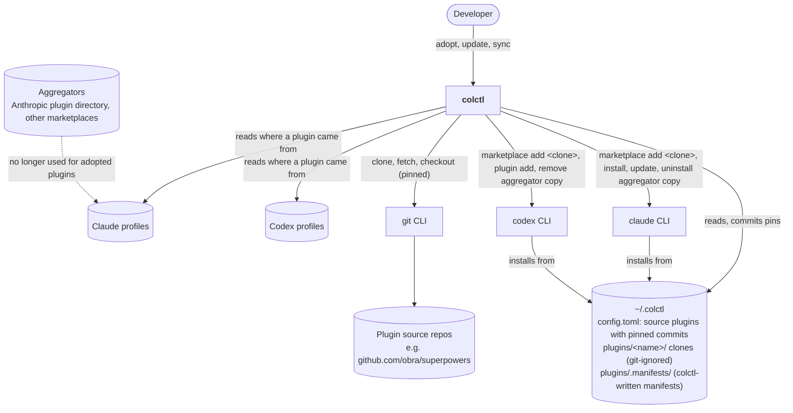

# System context (C4 level 1): Plugins from source

**Boundaries**
- colctl writes plugin code only into `~/.colctl/plugins`, and only by `git clone`/`fetch`/`checkout` of the
  declared repo at the declared commit. It never edits a clone.
- Each harness's own plugin cache is still written by its CLI.
- Aggregator marketplaces stay registered. Only the plugins colctl replaces are uninstalled.
