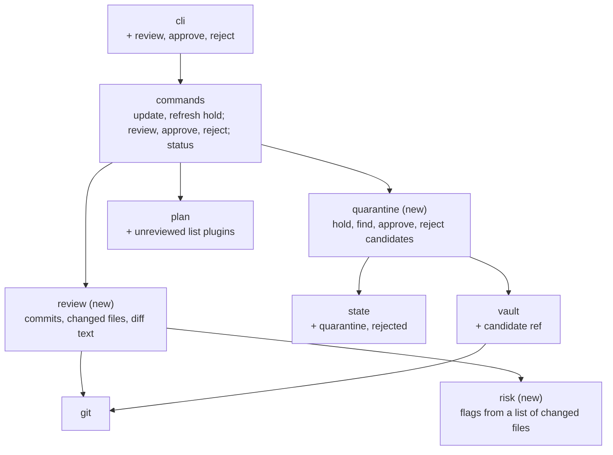

# Components (C4 level 3): Quarantine

| Component | One job | New / changed |
|---|---|---|
| `state` | `quarantine`: candidate key (`sources/<name>`, `skills/<name>`, `agents/<name>.md`) → what's held (plugin: from and to commit; skill or agent: origin, snapshot hash, base hash) and when. `rejected`: key → rejected commits or content hashes. Both optional, so 1.x state files load | Changed |
| `vault` | `hold(name, rev)` sets `refs/colctl/candidate`; `release(name)` deletes it; `has_commit` checks it's still there | Changed |
| `quarantine` | The rules. Hold a new version unless it's the current one or rejected, replacing an older held one. Snapshot and verify skill content. Approve: check the candidate is intact and the base hasn't moved, then produce the change (new pin, or snapshot → source copy). Reject: forget the candidate, remember its version. Pure where it can be; file and git work goes through `vault` and `fsx` | New |
| `review` | For one candidate: the commit list (plugins), changed files with status (added, modified, deleted, renamed, mode change) and the unified diff. Uses `git log`/`git diff` in the clone (the whole repo, even in a monorepo: EC4-09) and `git diff --no-index` for snapshots | New |
| `risk` | Pure: changed files (path, status, old/new content, executable bit, symlink) → flags (`hook`, `mcp`, `lsp`, `executable`, `script`, `binary`, `symlink`, `allowed-tools`, `inline-shell`, `manifest`), each with the file and a reason | New |
| `plan` | List plugins get `unreviewed` (informational, like `unsupported`). Status adds `pending-review` from the state's `quarantine` | Changed |
| `commands` | `update` and `refresh` hold instead of install. New `review`, `approve` (one, several, `--all`, `--dry-run`), `reject`. `rm source`/`rm skill` drop that item's candidate. `status` text and JSON show candidates | Changed |
| `cli` | The three new subcommands and their flags | Changed |

**Seams for testing:** `risk` is pure, so every flag gets table tests. `quarantine` rules run on a temp source with
local `file://` upstream repos, as in cycle 3. "The upstream moved after review" and "the snapshot was tampered
with" are set up by committing to the upstream fixture or editing the snapshot between steps.
