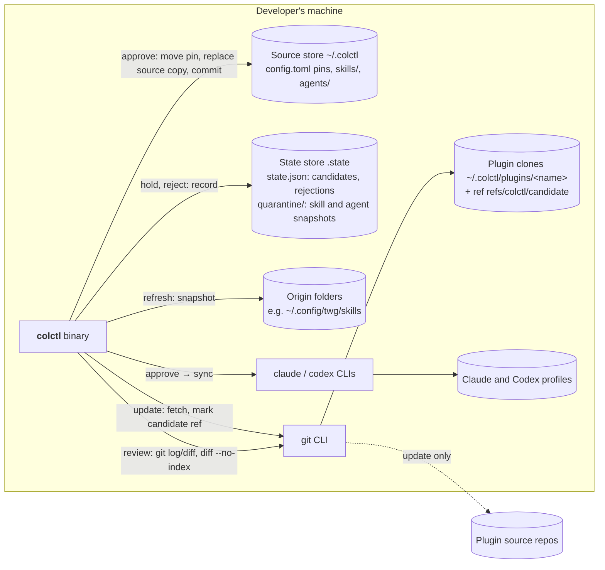

# Containers (C4 level 2): Quarantine

| Container | Change in cycle 4 |
|---|---|
| Source store | Unchanged in shape. Pins and source copies now move only on `approve` |
| Plugin clones | Each clone with a held update keeps a ref `refs/colctl/candidate`, so the commit survives `git gc` and upstream force-pushes until it's approved or rejected |
| State store | `state.json` gains `quarantine` (held candidates) and `rejected` (rejected versions). `.state/quarantine/<kind>/<name>` holds exact snapshots of held skills and agents. `.state/` is already git-ignored, so nothing held is ever committed |
| git CLI | Also used for `log` and `diff` between the pin and the candidate, and `diff --no-index` between a source copy and its snapshot. No new dependency |
| claude / codex CLIs | Called only by `approve` (through sync), never by `update` or `refresh` |
