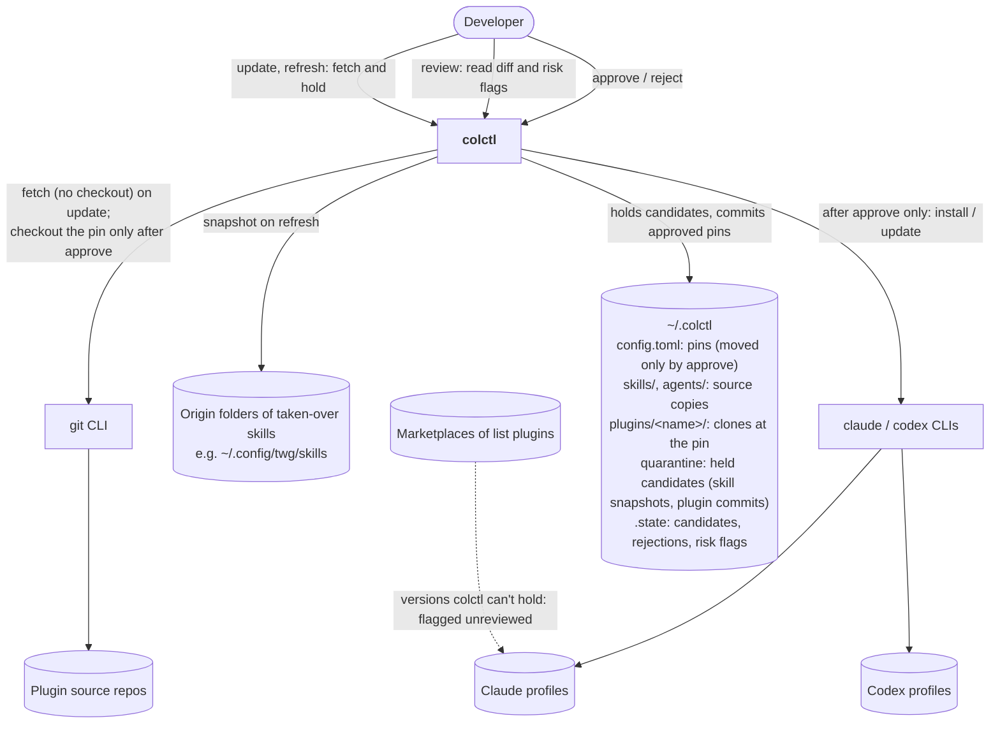

# System context (C4 level 1): Quarantine

**Boundaries**
- `update` and `refresh` only write to `~/.colctl`'s quarantine area, its state and the clones' git objects.
  They never check out a new commit, change a source copy, commit a pin or call `claude`/`codex`.
- `approve` is the only path from a candidate into a harness, and it installs the held candidate, not whatever
  upstream or the origin holds by then.
- colctl doesn't judge code. Risk flags point the owner at files; the decision is the owner's.
- List plugins' versions stay under their marketplace and the harness's own auto-update. colctl only reports them.
