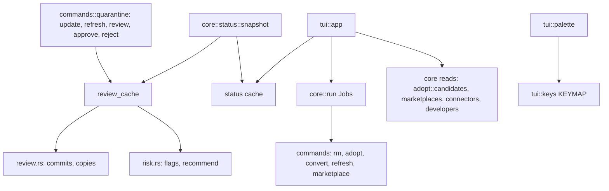

# Components: solid

_Cycle 9 · Orchestrate · C4 level 3_

| Component | Change |
|---|---|
| `review_cache` (new) | `get(key, identity) -> Option<CachedReview>`, `put`, `remove`, `prune(held keys)`. Stores the `Review` minus the diff, the Codex package change, and the recommendation, as JSON with a schema version |
| `commands::quarantine::inspect` | Asks the cache first when no diff is wanted; on a miss, inspects and stores |
| `core::status` | Saves the snapshot it returns; `last(ctx)` reads it back |
| `core::run::Job` | Six new variants, each calling its command's existing function |
| `core::{adopt, marketplaces, connectors, developers}` | Read calls returning plain structs, shared with the commands' `--json` |
| `tui::tabs` | New actions on Items, Profiles and Discover |
| `tui::palette` (new) | Fuzzy list over `KEYMAP`, filtered to actions valid now |
