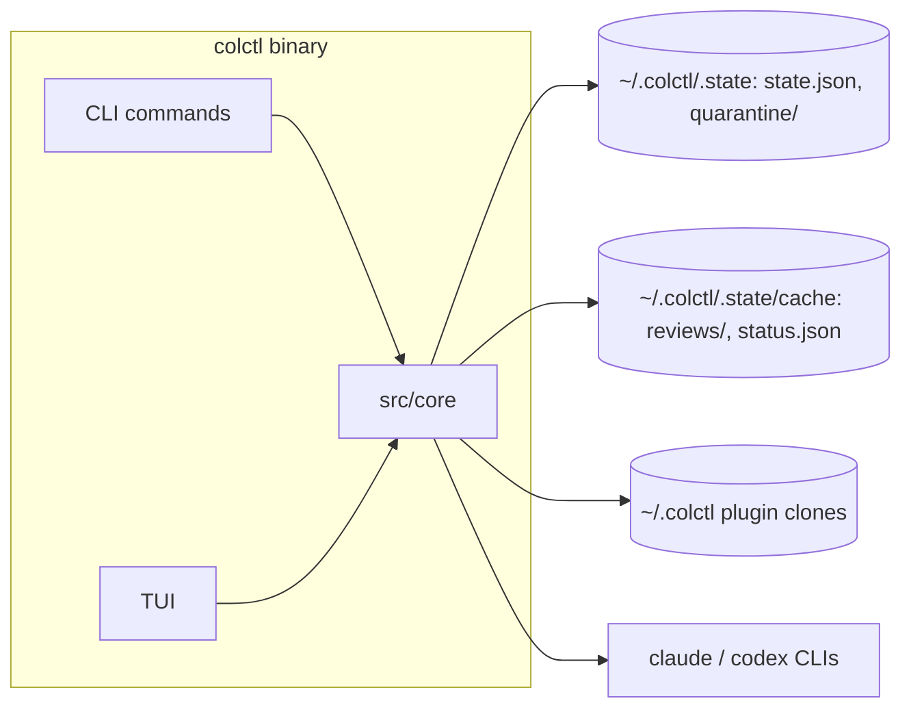

# Containers: solid

_Cycle 9 · Orchestrate · C4 level 2_

colctl is still one binary. What it reads and writes:

- **New: `.state/cache/`.** Derived data only. Git-ignored like the rest of `.state`. Deleting it is always safe; the
  next run recomputes.
- Nothing new runs in the background outside the TUI's own worker thread.
