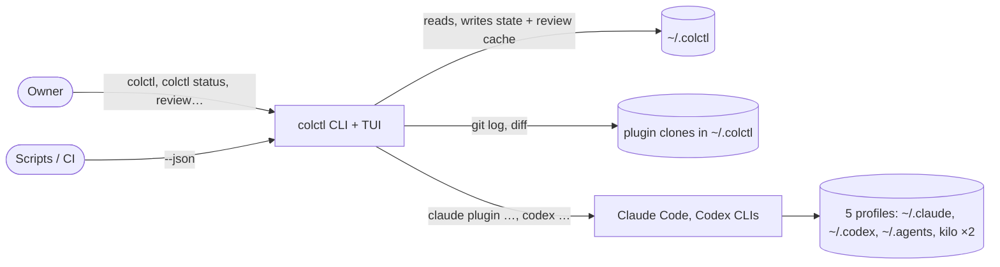

# System context: solid

_Cycle 9 · Focus · C4 level 1_

What changes this cycle:

- **New inside `~/.colctl`:** a review cache, one entry per held version, keyed by what was held (commit or content
  hash). Deleting it costs one slow run, nothing else.
- **No new external systems.** The commands now on TUI screens (adopt, convert, rm, refresh, marketplace, connectors,
  developers) call the same tools they already call from the CLI.
