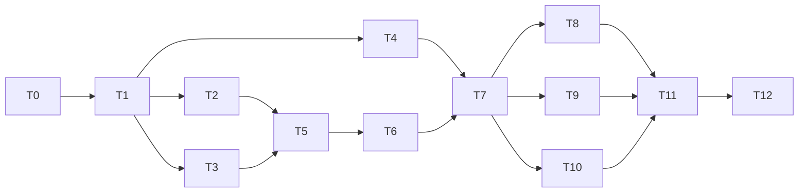

# Tasks: Claude profile sync

_Cycle 1 · Orchestrate · 2026-11-12_

Each task is one session, ends with `just check` green, and lists the acceptance criteria (see
[acceptance-criteria.md](../claude-profile-sync/acceptance-criteria.md)) its tests must cover. Generate is strict TDD:
a failing test named `ac_NN_…` or `ec_NN_…` comes first.

| # | Task | Agent | Needs | Produces | ACs / ECs |
|---|---|---|---|---|---|
| T0 | **Scaffold.** `cargo init`, `sadr init --public`, add `publish.yml` (binaries + attestations, adapted from sadr's), coverage gate (`cargo llvm-cov --fail-under-lines 90`) in `just check`, commit `.forge/` + `docs/` | DevOps | — | Repo, CI, release pipeline | AC-33, AC-35 (gate) |
| T1 | **Test harness.** Temp `HOME`/`$COLCTL_HOME` fixture, fake `claude` script (records argv + env, edits `installed_plugins.json` / `known_marketplaces.json`, can be told to fail), helpers to build harness folders | Tester | T0 | `tests/support/` | used by all |
| T2 | **`config`** model, parsing, validation, `~` expansion | Developer | T1 | `config` | AC-01…03; EC-01, 02, 09, 10 |
| T3 | **`fsx` + `state`** atomic link/write, tree hash, state file, lock | Developer | T1 | `fsx`, `state` | AC-29; EC-21, 23, 24, 27 |
| T4 | **`runner` + `git`** | Developer | T1 | `runner`, `git` | AC-32; EC-26 |
| T5 | **`adapter::claude` scan + `source`**: read a harness into `Actual`, the source into `Desired` | Developer | T2, T3 | `adapter`, `source` | AC-08 (scan); EC-05…08, 12, 13, 16, 20 |
| T6 | **`plan`** (pure): statuses + actions for links, `CLAUDE.md`, plugins | Developer | T5 | `plan` | AC-09…11, 13…15; EC-03, 04, 14, 15, 17, 18, 19 |
| T7 | **`apply`** + plugin actions through `runner` | Developer | T4, T6 | `apply` | AC-12, 16, 30, 31; EC-11, 22, 25, 28 |
| T8 | **`init` + `status`** commands, human and `--json` output, exit codes | Developer | T7 | 2 commands | AC-04…08 |
| T9 | **`sync`, `add`, `rm`** | Developer | T7 | 3 commands | AC-17…23 |
| T10 | **`adopt`** | Developer | T7 | 1 command | AC-24…28; EC-29…31 |
| T11 | **Docs** (Diataxis): tutorial (first init + sync), how-tos (add a profile, adopt what you have, add a plugin), reference (commands, `config.toml`, exit codes, state), explanation (links vs copies, ownership) | Documentation | T8–T10 | `docs/*` | AC-34 |
| T12 | **Review + smoke**: code and security review; smoke test on the author's Mac against `~/.claude` and the kilo profile; `cycle-review.md` | Reviewer, Tester | T11 | Evaluate artifacts | AC-35, SC-1…8 |

## Dependency map and build order

Parallel: T2, T3, T4 after T1; T8, T9, T10 after T7.
