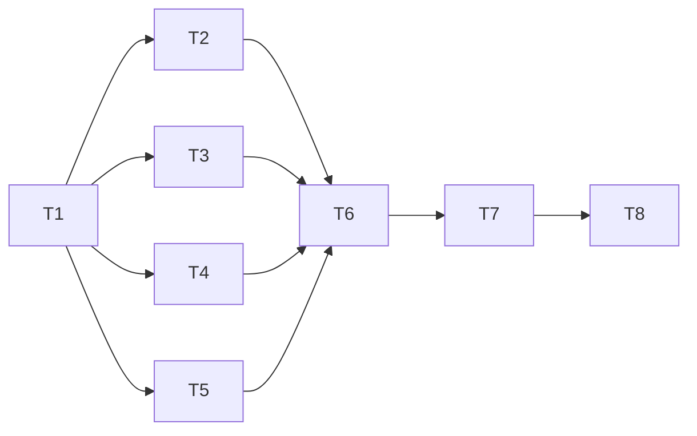

# Tasks: CLI output design

_Cycle 6 · Orchestrate · 2026-11-13_

Strict TDD as in cycles 4 and 5: each PR is opened on its RED commit and CI fails before GREEN is pushed. The gate
passes locally before every push.

| # | Task | Needs | Produces |
|---|---|---|---|
| T0 | **Sources install from the pinned clone** (found during Refine): a wrapper marketplace when the repo's manifest points elsewhere; move existing installs; sync reports a source that doesn't converge. Ships first, as its own patch release (v2.1.1), because it lets unreviewed code past quarantine | — | Correct installs |
| T1 | **Foundation**: `ui::term`, `ui::style`, `ui::render`, `ui::errors`, `Out`; global flags; a JSON golden test recorded from 2.1 that must stay byte-identical; a guard that no command prints directly (allow-list shrinking to zero by T6) | — | The output layer |
| T2 | **`status`**: verdict, per-profile summary, problems only with fixes, `--all`; source section (uncommitted, held, origin changes) in the same style | T1 | Calm status |
| T3 | **Running commands**: `apply` emits step events; `ui::progress`; outcome summaries for `sync`, `add`, `rm`, `adopt`, `approve`, `init` ("installed superpowers in 4 profiles"), tool calls under `-v`; fixes the "needs attention … in sync" contradiction | T1 | Live, readable runs |
| T4 | **Interaction**: `confirm` for `rm` and `reject`/`approve --all`; pickers for `approve`, `reject`, `review`, `show` without a name; pager for `review <name>` and long `search` | T1 | Asking when it helps |
| T5 | **The rest onto components**: `update`, `refresh`, `review` (flags grouped per file, aligned), `search`, `show`, `developers`, `marketplace`, `connectors`; every error with a hint | T1 | One look everywhere |
| T6 | **Help and completions**: grouped command list, accurate one-liners, examples on every command, `colctl completions <shell>`; the direct-print allow-list is empty | T2–T5 | A CLI that guides |
| T7 | **Snapshots and docs**: snapshot suite at 60/80/120 columns, colour on and off; `docs/reference/output.md` (the conventions), updated examples across the reference, explanation page; text declared unstable | T6 | Proof and docs |
| T8 | **Evaluate**: smoke on a copy of the real profiles in a real terminal (and piped); review; v2.2.0 | T7 | `cycle-review.md`, release |

T2–T5 all build on T1 and touch different commands, so they can go in any order.

## Criteria per task (from Refine)

| Task | Acceptance criteria | Edge cases |
|---|---|---|
| T1 | AC6-01 – 07 | EC6-01, 02, 03, 09, 16, 17, 18, 20 |
| T2 | AC6-08 – 11 | EC6-07, 08, 10, 11 |
| T3 | AC6-12 – 17 | EC6-04, 19 |
| T4 | AC6-18 – 20 | EC6-05, 06, 12, 13, 14, 15 |
| T5 | AC6-21 – 24 | — |
| T6 | AC6-25 – 27 | — |
| T7 | AC6-28 – 30 | — |
| T0 | AC6-31 – 33 | EC6-21, 22 |
