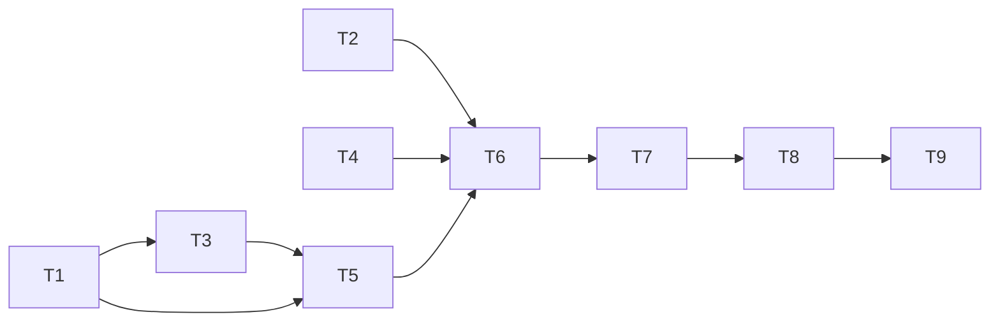

# Tasks: Codex CLI support

_Cycle 2 · Orchestrate · 2026-11-12_

**Strict TDD this cycle (SC-7).** Each task's branch gets a RED commit first (tests named `ac_NN_…` / `ec_NN_…`,
pushed so CI records them failing), then the GREEN commit that makes them pass. The PR is squash-merged, so `main`
still gets one commit per task. Each PR ends with `just check` green.

| # | Task | Agent | Needs | Produces |
|---|---|---|---|---|
| T1 | **Refactor, no behaviour change.** Split `adapter.rs` into `adapter/{mod,claude}.rs`, extract `tool.rs` from `apply.rs`, make `plan` builders kind-agnostic. All cycle 1 tests stay green, untouched | Developer | — | Seams for T3–T6 |
| T2 | **Test support.** `examples/fake_codex.rs` (marketplace add/remove, plugin add/remove → `$CODEX_HOME/config.toml`, logs argv and env, fail/sleep switches); `tests/support` gains Codex and `~/.agents` helpers | Tester | — | Fake + helpers |
| T3 | **`config`**: kinds `codex` and `agents`, `[codex]` table, validation, `--codex` edits | Developer | T1 | Config model |
| T4 | **`convert`**: agent `.md` → Codex `.toml` (pure) | Developer | — | Converter |
| T5 | **Scanning**: `adapter::codex`, `adapter::agents_dir` | Developer | T1, T3 | Scans |
| T6 | **Planning + applying** for both kinds: AGENTS.md link, generated agent TOML, Codex plugins via `tool` | Developer | T2, T4, T5 | Sync works end to end |
| T7 | **Commands**: `init` detection, `add`/`rm plugin --codex`, `adopt` for codex and agents items, `status --json` kinds | Developer | T6 | CLI surface |
| T8 | **Docs**: reference (config, commands, status kinds), how-to (add Codex), explanation (shared skills folder, generated agents) | Documentation | T7 | Docs |
| T9 | **Evaluate**: smoke test on copies of the real Codex profiles with the real `codex`, review, release | Reviewer, Tester | T8 | `cycle-review.md`, v1.1.0 |

## Dependency map

T1, T2 and T4 can run in parallel. One PR per task (T2 and T4 may share one).

## Criteria per task (from Refine)

| Task | Acceptance criteria | Edge cases |
|---|---|---|
| T1 | AC2-21 | — |
| T2 | (support for T6–T7) | — |
| T3 | AC2-01, 02, 03 | EC2-08, 09, 22 |
| T4 | AC2-08 (rendering), AC2-11 | EC2-05, 06, 10, 11 |
| T5 | AC2-16, AC2-24 (scan) | EC2-04, 07, 12, 13, 16, 21 |
| T6 | AC2-05, 07, 08, 09, 10, 12, 13, 14, 15 | EC2-01, 02, 03, 14, 15, 17, 18, 19, 20 |
| T7 | AC2-04, 06, 17, 18, 19, 20, 25, 26, 27, 28 | EC2-23…28 |
| T8 | AC2-22, 23 | — |
