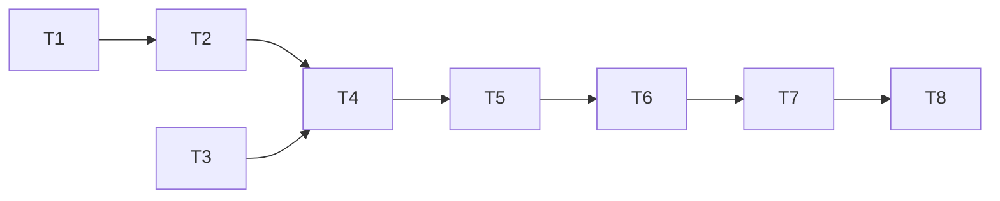

# Tasks: Convert

_Cycle 7 · Orchestrate · 2026-11-13_

Strict TDD as before: the PR is opened on the RED commit (formatted), CI fails on the tests, then GREEN. The gate
passes locally before every push.

| # | Task | Agent | Needs | Produces |
|---|---|---|---|---|
| T1 | **Repackager**: `Package` and `Report` from a clone; Codex `plugin.json` from Claude's (name, version, description, author, homepage, repository, license, keywords, `skills`, `interface.displayName`); skills; deterministic `write` | Developer | — | A package on disk |
| T2 | **Hook mapper**: events and matchers Codex runs, kept unchanged; the rest reported; malformed `hooks.json` is an error | Developer | T1 | Hooks in the package |
| T3 | **Config and state**: `convert` on `[[source]]`, validation; `Candidate::Conversion`; JSON shapes additive | Developer | — | Records |
| T4 | **`colctl convert`**: hold a conversion (text, `--json`, `--dry-run`), `--undo`; review, approve and reject a conversion | Developer | T1–T3 | The command |
| T5 | **Sync and status**: install from the converted package via `colctl-<name>`; rebuild when stale; status fixes and counts; native packaging replaces the conversion and says so | Developer | T4 | qdrant in Codex |
| T6 | **Updates**: a converted source's new commit is held with its conversion; review shows both; approve installs both | Developer | T5 | Updates |
| T7 | **Docs**: reference `convert`, how-to (get a Claude-only plugin into Codex), explanation (what converts and why); traceability for AC7/EC7 | Documentation | T4–T6 | Docs |
| T8 | **Evaluate**: smoke on a copy of the real profiles with qdrant-skills and a hooks fixture; review; release | Reviewer, Tester | T7 | `cycle-review.md`, release |

T1 and T3 are independent. **Release:** a new command and a new config field, no breaking change, so v2.3.0.
