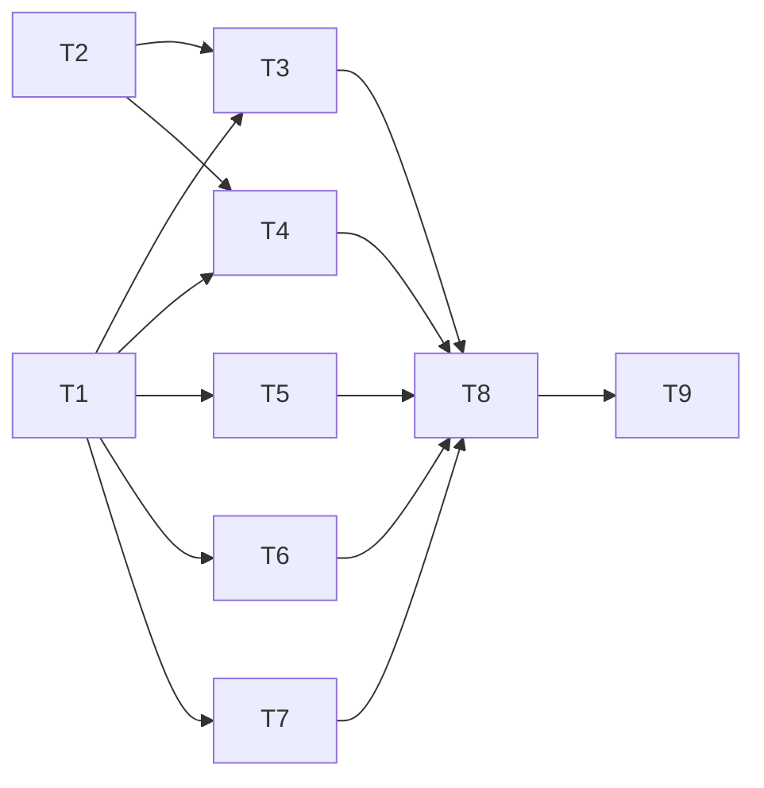

# Tasks: Discovery

_Cycle 5 · Orchestrate · 2026-11-13_

Strict TDD as in cycle 4: the PR is opened on the RED commit, CI fails, then GREEN. The gate passes locally before
every push.

| # | Task | Agent | Needs | Produces |
|---|---|---|---|---|
| T1 | **`catalog`**: entries from Claude marketplaces, the plugin-directory cache, Codex local/git marketplaces and colctl's sources; installed markers; warnings for unreadable catalogs | Developer | — | One list of entries |
| T2 | **`search`**: merge, match, rank, filter, group by developer (pure) | Developer | — | Results |
| T3 | **`search` and `show` commands**, text and JSON; timing check over ~4,000 entries | Developer | T1, T2 | Search |
| T4 | **`developers`** command | Developer | T1, T2 | Browse by developer |
| T5 | **`marketplace list` and `marketplace refresh`**; fake CLIs learn the update/upgrade calls | Developer | T1 | Marketplaces |
| T6 | **`connectors`**: Codex remote catalog via the CLI, per profile in parallel; fake `codex` learns `plugin list --available --json` | Developer | T1 | Connectors |
| T7 | **`add source <id>`**: resolve a catalog id to repo, subpath and plugin; ambiguity and no-repo cases | Developer | T1 | One-step add |
| T8 | **Docs**: reference pages, how-to (find and add a plugin), explanation (where the catalogs come from); traceability for AC5/EC5 | Documentation | T3–T7 | Docs |
| T9 | **Evaluate**: smoke on a copy of the real profiles with the real catalogs; review; release | Reviewer, Tester | T8 | `cycle-review.md`, release |

T1 and T2 are independent. **Release:** new commands only, no breaking change, so v2.1.0.

## Criteria per task (from Refine)

| Task | Acceptance criteria | Edge cases |
|---|---|---|
| T1 | AC5-01 – 07 | EC5-02, 03, 04, 05, 06 |
| T2 | AC5-08 – 11 | EC5-07, 08, 09 |
| T3 | AC5-12 – 16 | EC5-01, 10, 11, 12, 13, 14 |
| T4 | AC5-17, 18 | — |
| T5 | AC5-19, 20 | EC5-17 |
| T6 | AC5-21, 22 | EC5-15, 16 |
| T7 | AC5-23 – 26 | EC5-18 – 21 |
| T8 | AC5-27, 28 | — |
