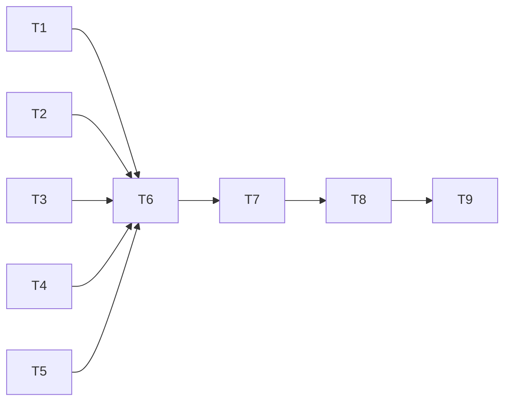

# Tasks: Plugins from source

_Cycle 3 · Orchestrate · 2026-11-12_

Strict TDD as in cycle 2: each task branch pushes a RED commit (tests failing in CI) before the GREEN commit.

| # | Task | Agent | Needs | Produces |
|---|---|---|---|---|
| T1 | **`config`**: `[[source]]` parsing, validation, edits (add, set rev, remove, replaces) | Developer | — | Config model |
| T2 | **`git` + `vault`**: clone, fetch, checkout at pin, dirty check, upstream head; tests use local `file://` repos | Developer | — | Pinned clones |
| T3 | **`packaging`**: detect each tool's packaging in a clone; write a one-plugin manifest when missing | Developer | — | Install targets |
| T4 | **`origin`**: find the source repo + commit of an installed Claude or Codex plugin | Developer | — | Origins |
| T5 | **Fakes + test support**: fake `claude`/`codex` handle local-folder marketplaces (name from the manifest), `marketplace update`, `plugin update`; helpers to build upstream repos | Tester | — | Test rig |
| T6 | **Plan + apply**: install from the clone, update when the pin moves, uninstall `replaces`, `unsupported`, `from-aggregator`; state records the installed commit | Developer | T1–T5 | Sync works |
| T7 | **Commands**: `update` (`--check`, `--rev`), adopt → source, `rm` of a source plugin, status/JSON | Developer | T6 | CLI surface |
| T8 | **Docs**: reference (`[[source]]`, `update`, adopt, status states), how-to (move a plugin to its source; update plugins), explanation (why sources, why pins) | Documentation | T7 | Docs |
| T9 | **Evaluate**: smoke on copies of the real profiles with real `claude`, `codex`, `git` and the real superpowers repo; review; v1.2.0 | Reviewer, Tester | T8 | `cycle-review.md`, release |

T1–T5 are independent of each other.

## Criteria per task (from Refine)

| Task | Acceptance criteria | Edge cases |
|---|---|---|
| T1 | AC3-01, 02, 03 | EC3-09, 17 |
| T2 | AC3-04, 05, 06 | EC3-02, 03, 08, 14, 16 |
| T3 | AC3-07, 08, 09 | EC3-04, 05, 06, 11 |
| T4 | AC3-19, 20 (finding the source) | EC3-18 |
| T5 | (support) | — |
| T6 | AC3-10, 11, 12, 23, 24, 25 | EC3-01, 07, 10, 12, 13 |
| T7 | AC3-13–18, 21, 22 | EC3-15 |
| T8 | AC3-26, 27, 28 | — |
