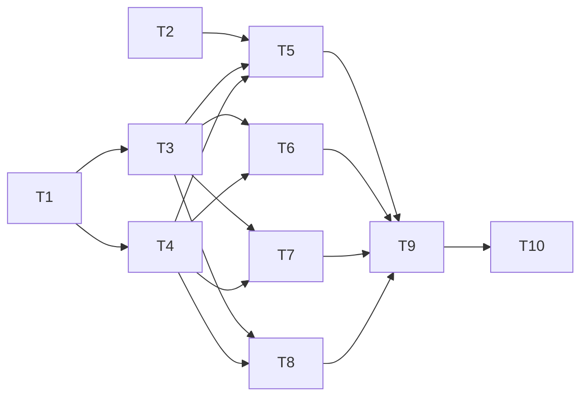

# Tasks: Quarantine

_Cycle 4 · Orchestrate · 2026-11-12_

Strict TDD as in cycles 2 and 3: each task branch pushes a RED commit (tests failing in CI) before the GREEN commit.
The gate (`just check`) passes locally before every push.

| # | Task | Agent | Needs | Produces |
|---|---|---|---|---|
| T1 | **`state` + `vault`**: `quarantine` and `rejected` in state (1.x files still load); `.state/quarantine/` layout; candidate ref hold/release | Developer | — | Storage for candidates |
| T2 | **`risk`**: pure flagger over a list of changed files, every flag kind and the no-flag case | Developer | — | Risk flags |
| T3 | **`quarantine` + `update`**: `update` holds a new commit instead of moving the pin; skips the current and rejected commits; a newer commit replaces an older held one; `--check` and `--rev` | Developer | T1 | Held plugin updates |
| T4 | **`quarantine` + `refresh`**: `refresh` snapshots the origin into quarantine and leaves the source copy; "changed in both places" and "origin gone" still refuse | Developer | T1 | Held skill/agent refreshes |
| T5 | **`review`**: list all candidates, or one in detail (commits, files, diff, flags); `--json`; monorepo path limit | Developer | T2–T4 | Review |
| T6 | **`approve`**: plugins (pin → candidate, commit, sync, release the ref) and skills/agents (verify snapshot and base, replace, commit, sync); several names, `--all`, `--dry-run` | Developer | T3, T4 | Approval |
| T7 | **`reject` + cleanup**: forget and remember; `rm source`/`rm skill` drop candidates; `update` and `refresh` honour rejections | Developer | T3, T4 | Rejection |
| T8 | **`status`**: `pending-review` and `unreviewed`, text and JSON, exit codes | Developer | T3, T4 | Visibility |
| T9 | **Docs**: reference (`review`, `approve`, `reject`, changed `update`/`refresh`/`status`/`state`), how-to (review an update), explanation (quarantine and its limits); traceability for AC4/EC4 | Documentation | T5–T8 | Docs |
| T10 | **Evaluate**: smoke on copies of the real profiles with real `claude`, `codex`, `git` and the superpowers repo; review; v2.0.0 | Reviewer, Tester | T9 | `cycle-review.md`, release |

T1 and T2 are independent of each other. T3 and T4 can run in either order.

**Release:** the first PR that changes `update` or `refresh` behaviour carries a `BREAKING CHANGE:` footer so
release-please cuts v2.0.0.

## Criteria per task (from Refine)

| Task | Acceptance criteria | Edge cases |
|---|---|---|
| T1 | AC4-01, 02, 03 | EC4-04 |
| T2 | AC4-04 – 10 | EC4-21, 23 |
| T3 | AC4-11 – 16 | EC4-01, 05, 06, 07, 17, 20 |
| T4 | AC4-17, 18 | EC4-10, 18 |
| T5 | AC4-19 – 22 | EC4-02, 03, 08, 09, 22 |
| T6 | AC4-23 – 26 | EC4-11, 12, 13, 14, 15, 16, 19 |
| T7 | AC4-27, 28 | — |
| T8 | AC4-29, 30, 31 | — |
| T9 | AC4-32, 33 | — |
