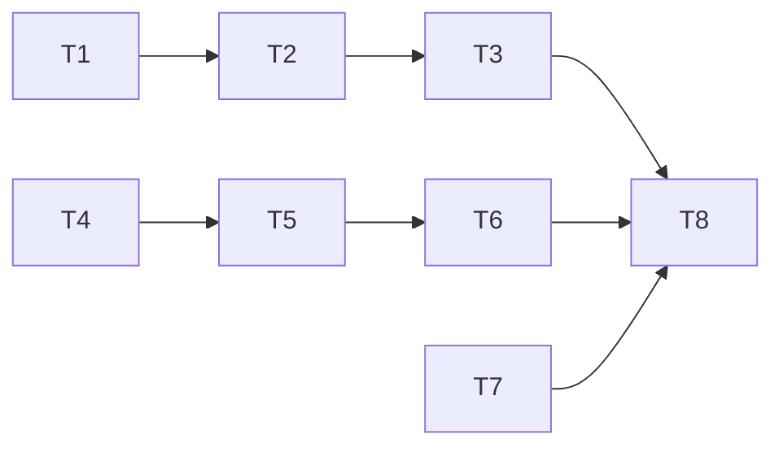

# Tasks: solid

_Cycle 9 · Orchestrate · 2026-11-15_

Each task is one PR: a RED commit (tests named after its AC/EC ids, failing in CI), then GREEN. CLI work lands before
the screen that uses it.

| # | Task | Depends on | Success criteria |
|---|---|---|---|
| T1 | **Measure.** Time each step of inspecting a held version (git log, file list, risk flags, the Codex package) on a copy with databricks and qdrant-skills held. Record the numbers in the cycle file | — | S1 |
| T2 | **Review cache.** `src/review_cache.rs`: one entry per held version in `.state/cache/reviews/`, keyed by candidate key + what was held (commit pair or content hash) + colctl's version + the risk rules' version. Written by `update` and `refresh`; read by `status`, `review`, `core::quarantine`; a miss or a corrupt entry recomputes; approve, reject and a new hold remove or replace the entry; entries for versions no longer held are pruned. The diff is never cached | T1 | S1, S2, S3, S7 |
| T3 | **TUI opens on the last state.** `core::status` saves its snapshot to `.state/cache/status.json`; the TUI draws it at once, marked with its age, and replaces it when the fresh snapshot arrives. No file, or a version mismatch: today's behaviour | T2 | S4 |
| T4 | **Core jobs for the rest.** `Job::{Rm, Adopt, Convert, ConvertUndo, Refresh, MarketplaceRefresh}` and read calls `core::{adopt::candidates, marketplaces, connectors, developers}`, each the same code path as its command, with a parity test. CLI gaps found here are fixed in the CLI first | — | S5, S7 |
| T5 | **Screens.** Items: `x` remove, `c` convert / undo for a source, `f` refresh a taken-over skill or agent. Profiles: `a` adopt what a profile has that `~/.colctl` doesn't (pick, then confirm). Discover: `v` cycles Plugins, Developers, Marketplaces (`u` refresh) and Connectors. Every write asks first, shows the plan, and ends in the result overlay | T4 | S5 |
| T6 | **Command palette.** `:` or Ctrl-K opens a fuzzy list of every action in every tab, with its key; ⏎ runs it as if the key was pressed | T5 | S5 |
| T7 | **Follow-ups.** `allowed-tools` flags grouped into one per plugin; `-v` paths as `~/…`; the `ETXTBSY` flake (write fake tools to a temp name, then rename); connectors' empty fields omitted; `colctl marketplace` with no subcommand prints help instead of an empty error; `sync`'s "needs attention" wording; status names `colctl adopt` for a plugin installed from somewhere other than colctl's clone | — | S6 |
| T8 | **Docs, smoke test, release.** Reference, tutorial and explanation pages; a smoke test on a copy of the real profiles with both updates held, timed; cycle review | T1–T7 | all |

## Dependency map

T1→T3 and T4→T6 are independent tracks; T7 can land at any point.
