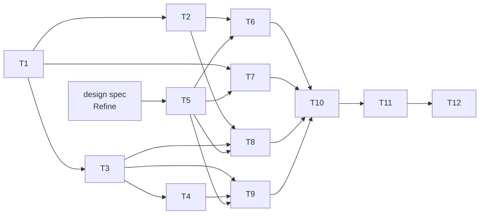

# Tasks: TUI

_Cycle 8 · Orchestrate · 2026-11-14_

Strict TDD as before: the PR is opened on the RED commit (formatted), CI fails on the tests, then GREEN. The gate
passes locally before every push. CLI tasks (T1–T4) land before the screens that use them. Extraction tasks are pinned
by the existing snapshot and JSON tests: CLI output must not change byte for byte, except `search` ranking in T4.

| # | Task | Agent | Needs | Produces |
|---|---|---|---|---|
| T1 | **Core status**: `core::status::snapshot` returns a typed `Snapshot`. `status` text and `--json` render from it, byte-identical | Developer | — | The data every tab reads |
| T2 | **Core runs and observer**: `Observer` trait. `sync`, `update`, `approve`, `reject` move into core, return typed reports, send progress through the observer and never print. The CLI renders as in 2.3 | Developer | T1 | Actions the TUI can run |
| T3 | **Core review and discovery**: `held`, `review(name)`, `catalog`, `show`, `add` return data. The CLI renders as in 2.3 | Developer | T1 | Data for Review and Discover |
| T4 | **Fuzzy search in the CLI**: one nucleo ranker in core. `colctl search` uses it (typos and partial words match, and the best match comes first), as documented in the reference | Developer | T3 | The ranker Discover reuses |
| T5 | **TUI shell**: launch rule, terminal guard, model/update/view loop, worker and channel, tab bar, key bar, `?` overlay, too-small screen, mouse, theme tokens, `NO_COLOR`. A test harness: TestBackend plus insta, key scripts | Developer | design spec | An empty app with five tabs |
| T6 | **Overview and Profiles, with sync**: the verdict, profile lines and what needs you, each fix runnable. Sync shows progress per profile and ends with the verdict. Profiles drill into a profile | Developer | T2, T5 | The daily view |
| T7 | **Items**: every item by kind across profiles with its state per profile, `/` to filter, drill into one item | Developer | T1, T5 | The inventory |
| T8 | **Review**: held list with counts in the tab, detail (commits, files, risk flags, scrollable diff), check for updates with progress, approve or reject after a confirmation | Developer | T2, T3, T5 | The review loop |
| T9 | **Discover**: catalog loads in the background, fuzzy results as you type, plugin detail, add with progress | Developer | T3, T4, T5 | Discovery |
| T10 | **Motion**: tachyonfx transitions for tabs, overlays and list changes. Reduced motion, and none in tests | Developer | T5–T9 | Polish |
| T11 | **Parity and docs**: one parity test per action (TUI vs CLI, same fixture, same resulting state). A tutorial (first look around), the reference (keys, launch rule, env vars) and README. Traceability for AC8/EC8 | Tester, Documentation | T6–T10 | Proof and docs |
| T12 | **Evaluate**: smoke on a copy of the real profiles in a real terminal (80×24, 120×40, `NO_COLOR`, reduced motion), review, release | Reviewer, Tester | T11 | `cycle-review.md`, v2.4.0 |

T1–T4 (the CLI) and T5 (the shell) are independent and can go in either order. Each is one PR. **Release:** a new way to
run colctl and an additive CLI change, no breaking change, so v2.4.0.

If a screen turns up another CLI gap during Generate, it becomes a CLI task of its own before that screen's GREEN, and
the cycle review lists it.
