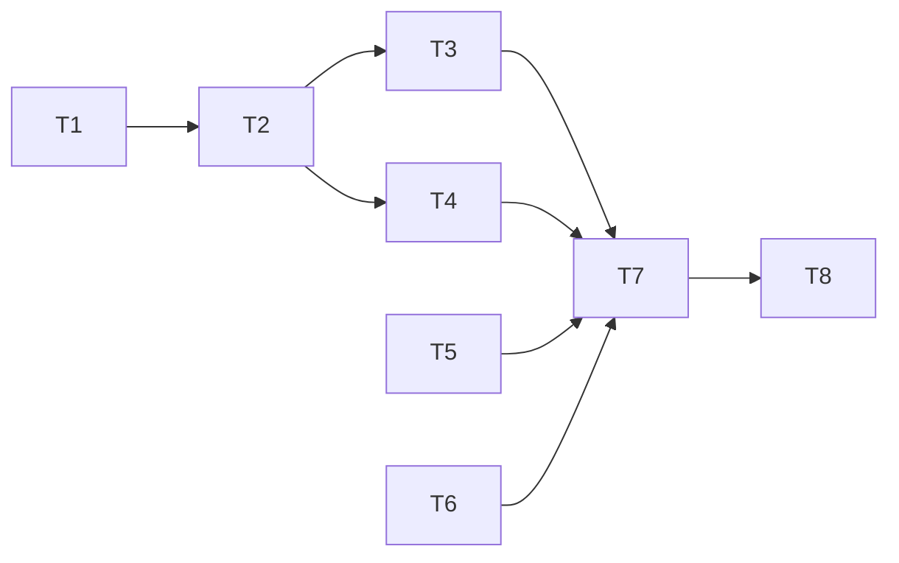

# Tasks: whole setup

_Cycle 10 · Orchestrate · 2026-11-18_

Each task is one PR: a RED commit (tests named after its AC/EC ids, failing in CI), then GREEN. CLI work lands before
the screen that uses it. The open points in the PRD ("To verify in Refine") are settled before Generate starts and
recorded in `docs/whole-setup/interfaces.md`.

| # | Task | Depends on | Success criteria |
|---|---|---|---|
| T1 | **MCP config and state.** `[[mcp]]` in `config.toml`: `name`, `command` + `args` or `url` (+ `headers`), `env`, which tools (default both), and `[mcp.profile.<harness>]` overrides for `env`, `args` or `headers`. A value is a literal or a reference: `{ env = "NAME" }` or `{ keychain = "item" }`. Parse, validate, and edit (add, remove) the text without losing comments. State records each server colctl added per harness, with a hash of what it passed (secrets hashed after resolving, never stored) | — | S2, S3, S4 |
| T2 | **MCP in the planner.** Adapters read each profile's servers read-only: Claude from the profile's `.claude.json` (`~/.claude.json` for the default profile), Codex from `config.toml`. `ItemKind::Mcp`, with states ok / missing / differs / foreign / orphaned. `Action::{AddMcp, RemoveMcp}` (a change is remove then add), argv for `claude mcp add\|remove -s user` and `codex mcp add\|remove` with the profile's environment, as for plugins | T1 | S1, S3, S7, S8 |
| T3 | **MCP commands.** `colctl add mcp <name> -- <command> [args]` / `--url`, with `--env KEY=value`, `--env-from KEY=NAME`, `--keychain KEY=item`, `--only claude\|codex`. `colctl rm mcp <name>`. `adopt` reads every profile's servers and writes one entry per name, shared values once and the rest as per-profile overrides. Status, sync, `--dry-run`, `--json` | T2 | S1, S2, S3 |
| T4 | **Secrets.** References resolved at apply (environment, then `security find-generic-password -w` for keychain items). An unresolvable reference skips that server with the fix named, and the rest of the sync goes on. Values that look like secrets are redacted in every output (plan, `-v`, `--json`, errors). A leak check in colctl's commit path refuses a literal that looks like a secret in `config.toml`. `adopt` turns a secret-looking literal into an env reference and says which variable to set | T2 | S4 |
| T5 | **Commands.** `~/.colctl/commands/<name>.md`. Linked into each Claude profile's `commands/` like skills. For Codex, generated as whatever Refine settles (most likely a skill) and recorded like generated agents. `add command <file>`, `rm command <name>`, adopt from a profile's `commands/`, status, sync, `--json` | — | S5, S8 |
| T6 | **Hooks.** `~/.colctl/hooks/hooks.json` plus its scripts. colctl packages them as its own plugin, `colctl-hooks`, in its own marketplace, and installs it in each Claude profile. For Codex, the same package goes through cycle 7's hook mapper, and what Codex can't run is listed by name. Adopt reads hooks from a profile's `settings.json` (read-only) into `~/.colctl` and tells the owner to remove the originals, because colctl doesn't edit `settings.json` | — | S6, S7, S8 |
| T7 | **TUI.** Items gets MCP servers, Commands and Hooks sections with their states. Actions: add (prompted), remove, adopt, all in the palette, all as `core::run` jobs with a parity test against the CLI | T3, T4, T5, T6 | S9 |
| T8 | **Docs, smoke test, release.** Reference pages (`add mcp`, `rm mcp`, `add command`, `[[mcp]]`, hooks file), a how-to ("Share an MCP server across tools", "Keep a secret out of ~/.colctl") and an explanation (why hooks travel as a plugin). Smoke test on a copy of the real profiles: adopt toolport, status in sync, sync a no-op; then a sample command and hook in all four profiles. Cycle review | T1–T7 | all |

## Dependency map

There are three independent tracks: MCP (T1 → T2 → T3 and T4), commands (T5) and hooks (T6). The TUI waits for all
three.
