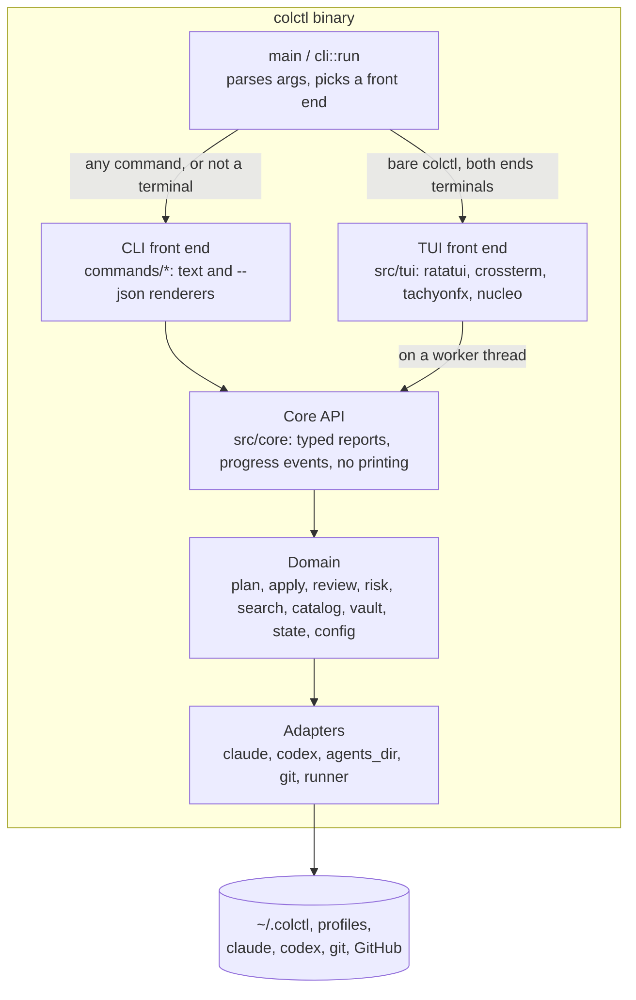

# Containers: TUI (C4 level 2)

colctl stays one binary. The TUI is a second front end next to the CLI, and both call one core.

| Container | Technology | Responsibility | New / changed |
|---|---|---|---|
| `cli::run` | clap | Parses arguments. Bare `colctl` opens the TUI when stdin and stdout are terminals, `TERM` isn't `dumb` and `CI` isn't set. Otherwise it prints the welcome help, as in 2.3 | Changed |
| CLI front end | `src/commands`, `src/ui` | Turns core reports into text (the cycle 6 output system) or `--json`. Asks and confirms in a terminal | Changed: renders from reports instead of computing |
| Core API | `src/core` (new) | One function per core-loop operation. Each returns a typed report, sends progress to an `Observer`, and never prints or prompts. Holds the lock while writing | New, extracted from `commands` |
| TUI front end | `src/tui` (new) | Full-screen app: model, update, view, worker thread, theme, motion | New |
| Domain, adapters | existing modules | Unchanged, apart from what extraction moves | — |

**Threads.** The TUI's main thread owns the terminal: input, ticks and drawing. One worker thread runs core calls and
sends `Event`s back over a channel (progress, a report, an error). Only one write runs at a time. Reads like loading the
catalog can overlap with it. No async runtime is added.

**New dependencies:** `ratatui` (with the `crossterm` backend), `tachyonfx` and `nucleo-matcher`. `nucleo-matcher` is
shared by `colctl search` and the TUI.
