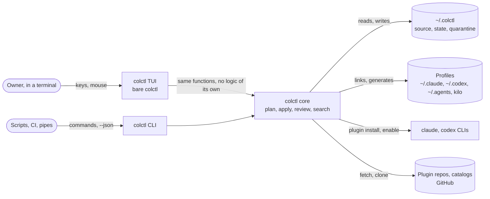

# System context: TUI (C4 level 1)

| Element | Role | Owned by |
|---|---|---|
| colctl TUI | Full-screen view over the core loop. Opens only for bare `colctl` in an interactive terminal | colctl (new) |
| colctl CLI | Every command, human output and `--json`. Gets each gap the TUI exposes first | colctl (cycles 1–7) |
| colctl core | Planning, applying, quarantine, review, search: what both front ends call | colctl |
| `~/.colctl` | The source of truth, its state and the held versions | colctl |
| Profiles | Where harnesses read skills, agents and plugins | Claude Code, Codex, kilo |
| claude, codex | Install and enable plugins when colctl asks | Anthropic, OpenAI |
| Plugin repos, catalogs | Where updates and search results come from | Third parties |

Trust boundaries are unchanged from the CLI. Upstream content is untrusted until reviewed (cycle 4), and the TUI
approves only what the owner confirms. The TUI adds one boundary of its own: the owner's terminal. It must be
restored on every exit path.
