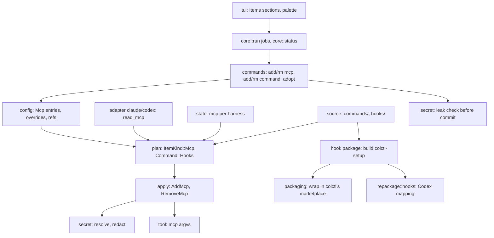

# Components: whole setup

_Cycle 10 · Orchestrate · C4 level 3_

| Component | Change |
|---|---|
| `config` | `Mcp { name, transport: Stdio{command,args} \| Http{url,headers}, env, tools, profiles: overrides }`, `Value::{Literal, Env, Keychain}`. `add_mcp`, `remove_mcp`, `set_mcp_override` edit the text |
| `secret` (new) | `resolve(&Value) -> Result<String>`, `looks_secret(&str) -> bool`, `redact(&str) -> String`, `leak_check(config_text) -> Vec<Finding>` |
| `adapter::claude` / `adapter::codex` | `read_mcp(profile) -> BTreeMap<String, McpEntry>`, read-only, from `.claude.json` / `config.toml` |
| `state::HarnessState` | `mcp: BTreeMap<name, hash>` of what colctl added. Added as an optional field: an older state file still parses |
| `plan` | `ItemKind::{Mcp, Command, Hooks}`; MCP states; `Action::{AddMcp, RemoveMcp}`; command links and Codex generation reuse `Link` / `WriteGenerated` |
| `tool` | `argvs` for `AddMcp` / `RemoveMcp` per tool, with secret values passed as arguments, never logged |
| `apply` | Resolves references just before running an MCP action; a failure is that item's outcome, not the run's |
| hook package (new, in `packaging`) | Builds `colctl-setup` from `hooks/` into colctl's marketplace folder; Codex gets it through `repackage::hooks` |
| `commands` | `add mcp`, `rm mcp`, `add command`, `rm command`; `adopt` extended to MCP, commands and hooks; `--json` gains `mcp`, `commands`, `hooks` |
| `core::run` / `core::status` | Jobs for each new command; snapshot includes the new kinds |
| `tui::tabs` / `tui::palette` | Items sections and actions; palette entries come from `KEYMAP` as before |
