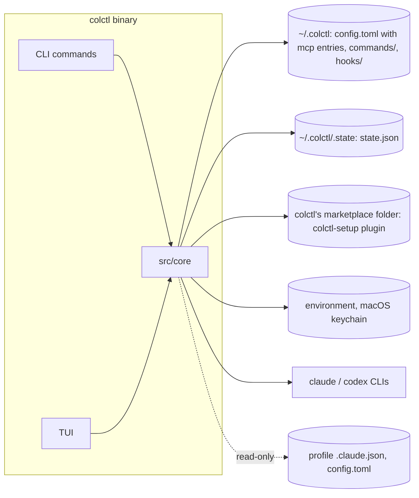

# Containers: whole setup

_Cycle 10 · Orchestrate · C4 level 2_

colctl is still one binary. What it reads and writes:

- **`~/.colctl` grows three things:** `[[mcp]]` entries, a `commands/` folder and a `hooks/` folder. All are committed
  as before. `config.toml` only ever holds references to secrets.
- **colctl's marketplace folder** gains a generated `colctl-setup` plugin. It's built from `hooks/` on each sync, the
  same way converted packages are wrapped today.
- **Secret stores are read at apply time only.** A resolved value is passed straight to the tool's CLI. It's never
  written to disk by colctl, logged or cached.
- **Profile config files are read, never written.** Writes go through `claude mcp`, `codex mcp` and the plugin CLIs.
