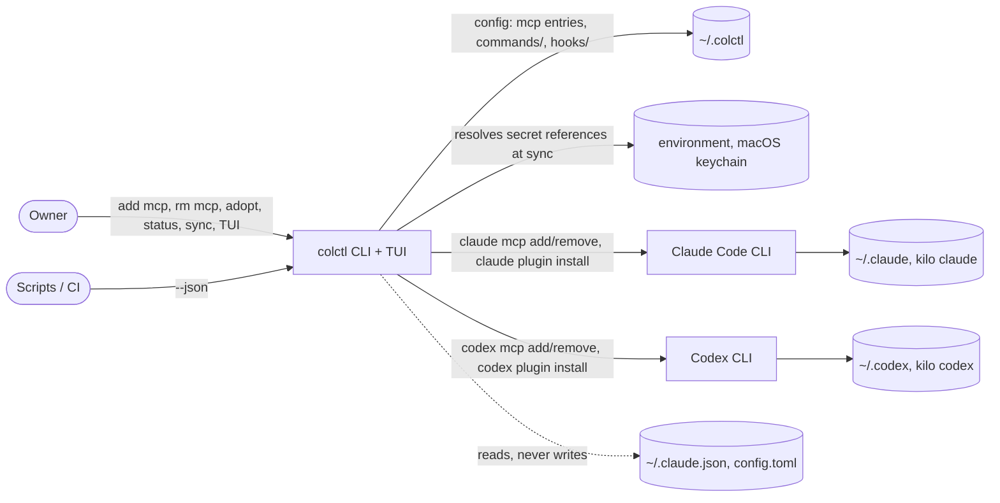

# System context: whole setup

_Cycle 10 · Focus · C4 level 1_

What changes this cycle:

- **New in `~/.colctl`:** MCP server entries in `config.toml` (shared values plus per-profile overrides; secrets as
  references only), a `commands/` folder and a hooks file. colctl packages the last two as its own plugin.
- **New external system: secret stores.** colctl reads an environment variable or a keychain item at sync, passes
  the value to the tool's CLI and never stores it.
- **New reads:** each profile's MCP servers, from `.claude.json` and `config.toml`. Read-only: `claude mcp list` would
  start every server.
- **Same writers as before:** everything a profile gets still goes through `claude` and `codex` themselves.
- **Not involved:** `~/.agents` (no MCP servers, commands or hooks).
